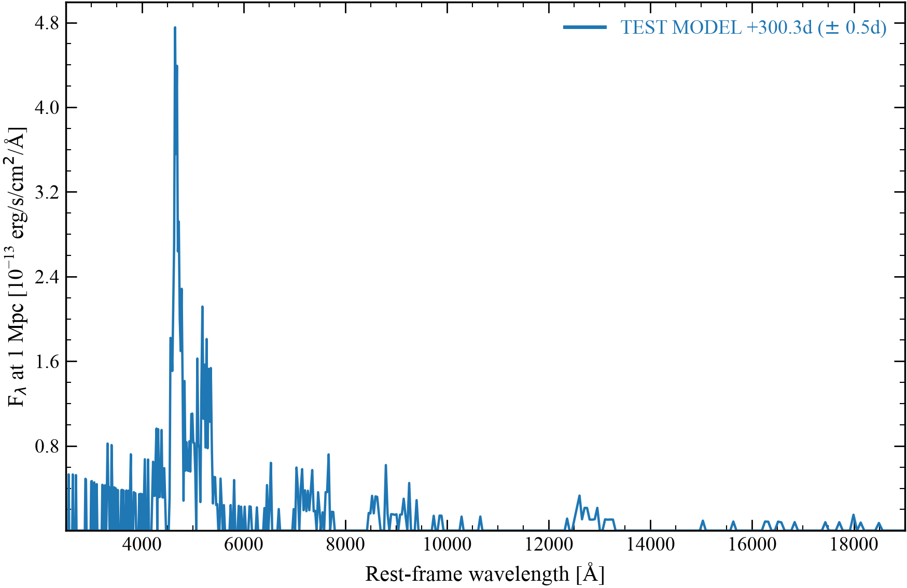
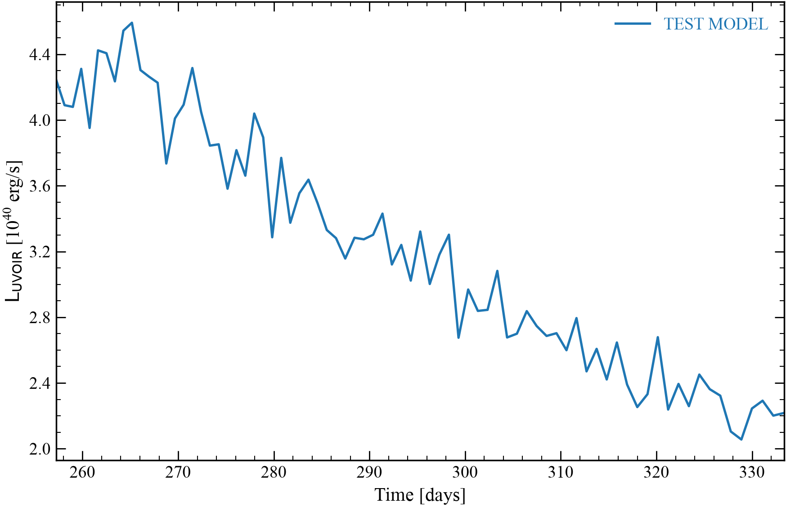
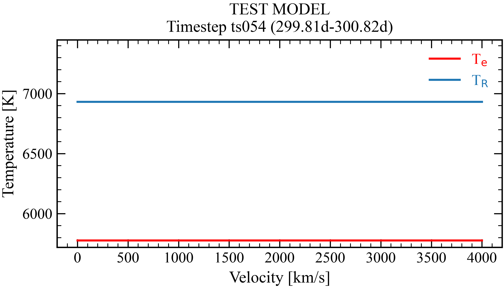
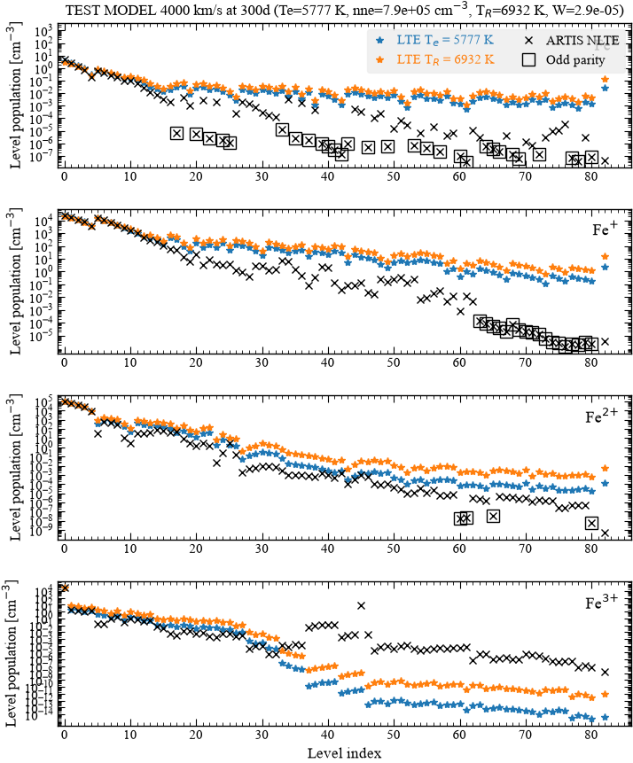

# Example outputs

This page shows the output of some common commands. Each command runs in the model folder of the test model, which is a 1D
model with one cell. The script `docs/make_examples.py` makes these outputs. The [commands page](commands.md) gives
the arguments of each command.

## Plots

### Spectrum

The spectrum at 300 days:

```sh
artistools plotspectra . -t 300
```



### Light curve

The bolometric light curve:

```sh
artistools plotlightcurves .
```



### Estimators

The electron temperature and the radiation temperature at 300 days. The lines are flat because the test model has one
cell.

```sh
artistools plotestimators Te TR . -t 300
```



### Non-LTE populations

Non-LTE means not in local thermodynamic equilibrium (LTE). The populations of the levels in one cell at 300 days:

```sh
artistools plotnltepops --modelpath . -t 300 --modelgridindex 0
```



## Text

### Summary of a model

```sh
artistools describe .
```

```{literalinclude} examples/describe.txt
:language: text
```

### Timesteps

This output shows only the first lines of the table.

```sh
artistools timesteps .
```

```{literalinclude} examples/timesteps.txt
:language: text
:lines: 1-12
```

### Plotted data as text

The option `--print-data` of a plot command prints the plotted data as tables. The last table gives the statistics
of each series.

```sh
artistools plotestimators Te . -t 300 --print-data
```

```{literalinclude} examples/plotestimators_print_data.txt
:language: text
```
